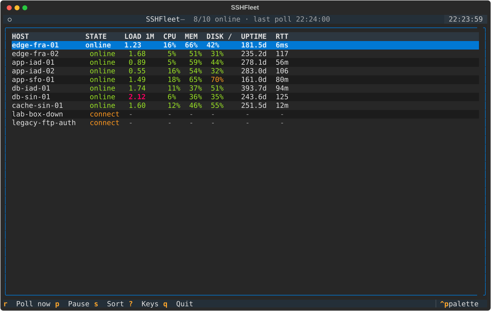
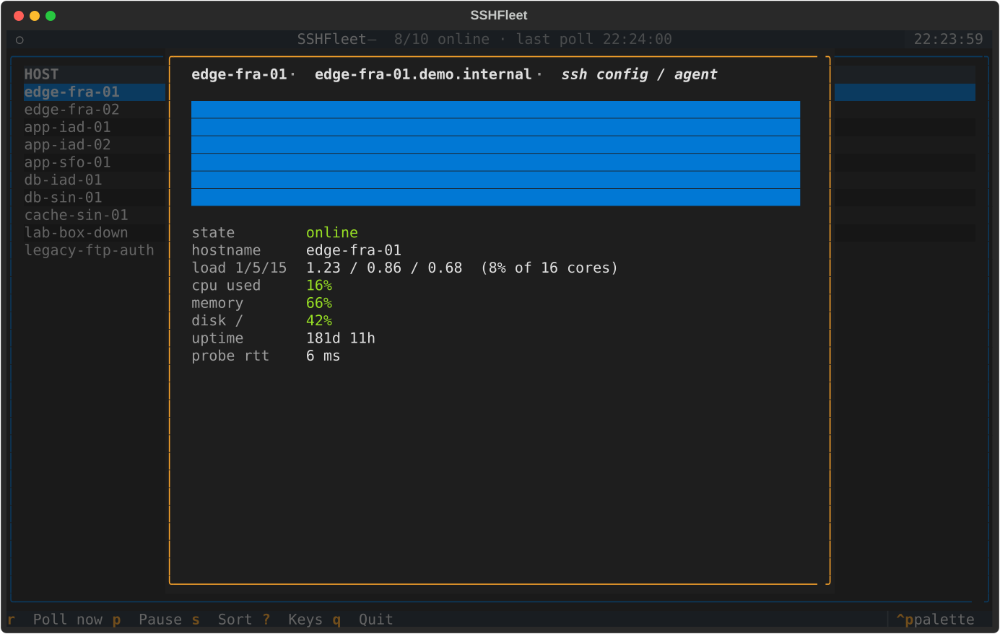

# SSHFleet

[](https://github.com/SHAWNiksDev/sshfleet/actions/workflows/ci.yml)
[](https://www.python.org)

Agentless TUI dashboard for monitoring a fleet of Linux servers over SSH.
One persistent connection and one compound `exec` command per host per poll
cycle; everything else is parsing, so the footprint on monitored machines is
close to zero.



## What it shows

| Column | Source |
| --- | --- |
| STATE | connection outcome: online / unreachable / auth-error |
| LOAD 1M | `/proc/loadavg` |
| CPU | delta of `/proc/stat` counters between two polls |
| MEM | `(MemTotal − MemAvailable) / MemTotal` from `/proc/meminfo` |
| DISK / | use% of the root mountpoint via `df -kP /` |
| UPTIME | `/proc/uptime` |
| RTT | round-trip time of the probe command |

Selecting a host opens a drill-down with the full metric set and a sparkline
of load-1 history.



## Install

```sh
pipx install git+https://github.com/SHAWNiksDev/sshfleet.git
```

or from a clone:

```sh
pip install .
```

Requires Python 3.11+. Authentication goes through your normal SSH setup:
agent, default keys in `~/.ssh`, or an explicit `identity_file` per host.

## Quickstart

Point it at an inventory file (see [`examples/fleet.example.toml`](examples/fleet.example.toml)):

```toml
[defaults]
user = "deploy"
interval = 10
timeout = 8
max_concurrent = 8
verify_hosts = true

[[hosts]]
name = "edge-fra-01"
host = "198.51.100.10"

[[hosts]]
host = "db.internal.lan"
port = 2222
```

Then run:

```sh
sshfleet                      # uses ./fleet.toml or ~/.config/sshfleet/fleet.toml
sshfleet --config other.toml  # explicit path
sshfleet --interval 5         # override the configured interval
```

No fleet at hand? Try the synthetic one:

```sh
sshfleet --demo
```

It generates ten hosts with random-walking metrics — including one
permanently down and one with broken credentials, so every UI state is
visible.

## Keys

| Key | Action |
| --- | --- |
| `r` | poll all hosts immediately |
| `p` | pause / resume background polling |
| `enter` | open detail view for the selected host |
| `s` | sort by the column under the cursor (press again to flip direction) |
| `?` | keymap overlay |
| `esc` | close overlay |
| `q` | quit |

## Configuration reference

`[defaults]`

| Key | Type | Default | Meaning |
| --- | --- | --- | --- |
| `user` | string | current user | SSH username fallback |
| `port` | int | 22 | port fallback |
| `interval` | float | 10 | seconds between poll cycles |
| `timeout` | float | 8 | login/command timeout per host |
| `max_concurrent` | int | 8 | simultaneous probes upper bound |
| `identity_file` | path | – | private key fallback (`~` is expanded) |
| `password` | string | – | password fallback (avoid; prefer keys/agent) |
| `verify_hosts` | bool | true | check server keys against known_hosts |

Every key can be overridden per host in `[[hosts]]`; only `host` itself is
required, `name` defaults to the address and must be unique.

### Authentication

SSHFleet authenticates exactly like your normal SSH client, in this order of
preference:

1. **SSH agent** — nothing to configure, just have `ssh-add` loaded.
2. **Default keys** — `~/.ssh/id_ed25519`, `~/.ssh/id_rsa`, and friends.
3. **Explicit key** — `identity_file` in `[defaults]` or per host.
4. **Password** — set `password` in `[defaults]` or per host. Note it sits in
   the TOML as plaintext, so `chmod 600 fleet.toml` and prefer the options
   above whenever you can.

## How it works

Each cycle probes every host concurrently under a semaphore. The first
successful contact reuses its connection for later cycles; a transport error
triggers exactly one reconnect before the host flips to unreachable.
Auth failures are never retried. CPU usage needs two samples, so the column
fills in on the second poll after startup or reconnect.

## Development

```sh
python -m venv .venv && source .venv/bin/activate
pip install -e ".[dev]"
pytest            # unit + TUI tests, no real servers involved
ruff check .
mypy sshfleet
python scripts/make_preview.py   # regenerate assets/*.svg from the demo fleet
```

The collector's SSH layer is fully injectable: tests drive scripted fake
connections instead of sockets, and the same seam powers `--demo`.

## License

MIT — see [LICENSE](LICENSE).
